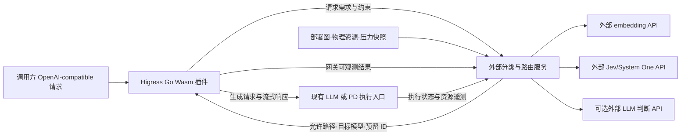

# Higress 外部分类与异构 PD 路由：现场调查及实施边界草案

调查日期：2026-10-22（Asia/Shanghai）。状态：已完成只读调查，等待用户一次性确认边界；尚未开始功能实现或 goal 运行。

后续确认：用户已启动 goal，明确首版不做 PD、多副本高可用与在线学习必须实现、生成流量由 Higress 转发、每个功能完成后推送远程。当前实施以[已确认范围的设计](../superpowers/specs/2026-10-22-adaptive-higress-routing.md)为准；本文保留原始调查及待确认建议，不能将其单协调器/PD 建议当作当前目标。

## 1. 用户目标与本轮产物

用户要求参考异构 PD 路由专利草案，在当前 Semantic Router 项目上实现 Higress 插件调用外部分类算法服务，并接入外部大模型、Jev、embedding API。外部大模型本身不需要实现。本机资源可以使用；本轮集中提问一次，后续 goal 模式自主执行。

本文件把已经核实的事实、建议设计、验收范围和缺失输入分开记录。参考仓库中的旧用户约定、旧硬件、旧路径及性能结果均不自动成为本次部署事实。调查未调用付费模型 API，未改动生产环境，未更改现有 Python 功能代码。

## 2. 来源及版本

| 来源 | 固定版本 / 文件 | 调查结论 |
|---|---|---|
| 当前工作仓库 | `/mnt/workspace/semantic-router`，`main`，HEAD `1fa1937` | Aurelio Semantic Router 1.1.1；调查开始时工作区干净 |
| 当前远程 | origin `cornjosh/semantic-router`；upstream `aurelio-labs/semantic-router` | 实现应扩展当前项目，不能把另一个同名 Python 包直接覆盖进来 |
| 用户参考仓库 | `cornjosh/sematic-router-awesome`，`5d4e9c944718fbe667a1374a6ba664081fc5bc62` | 私有归档仓库，通过已连接 GitHub 工具成功读取；公开网页读取 404 不表示资料不存在 |
| Higress 官方源码 | `higress-group/higress`，`829006d31e8575cf243bb65885d94478f4a8dc8c` | 核查 HTTP call、model-router、ai-intent、ai-endpoint-picker 及 Go 构建文件；该版本是调研基准，不等于用户现场版本 |

主要参考：

- [异构 PD 专利草案](https://github.com/cornjosh/sematic-router-awesome/blob/5d4e9c944718fbe667a1374a6ba664081fc5bc62/sematic-router/docs/patents/heterogeneous-pd-routing-patent-proposal.md)：正文 S1—S5、补充 D 的形式模型、补充 E 的反例。
- [旧分类服务说明](https://github.com/cornjosh/sematic-router-awesome/blob/5d4e9c944718fbe667a1374a6ba664081fc5bc62/sematic-router/README.md)、[Higress 接口约定](https://github.com/cornjosh/sematic-router-awesome/blob/5d4e9c944718fbe667a1374a6ba664081fc5bc62/sematic-router/docs/higress-contract.md)。旧实现没有 Wasm 插件或 Higress 联调。
- [Jev 调研](https://github.com/cornjosh/sematic-router-awesome/blob/5d4e9c944718fbe667a1374a6ba664081fc5bc62/sematic-router/docs/jev-research.md)、[分层架构设计](https://github.com/cornjosh/sematic-router-awesome/blob/5d4e9c944718fbe667a1374a6ba664081fc5bc62/sematic-router/docs/superpowers/specs/2026-10-20-adaptive-routing-design.md)、[在线反馈调研](https://github.com/cornjosh/sematic-router-awesome/blob/5d4e9c944718fbe667a1374a6ba664081fc5bc62/sematic-router/docs/online-feedback-routing-research.md)。后两项主要是提案，不能当作已经实现的系统。
- [旧评测报告](https://github.com/cornjosh/sematic-router-awesome/blob/5d4e9c944718fbe667a1374a6ba664081fc5bc62/sematic-router/results/comparison/REPORT.md)：160 条原创工程样本，72/32/56 划分；AMD ROCm gfx942 的测量，远程 Jev 没有实测。
- [Higress 官方 Go Wasm 开发文档](https://higress.io/docs/latest/user/wasm-go/)、[model-router](https://github.com/higress-group/higress/blob/829006d31e8575cf243bb65885d94478f4a8dc8c/plugins/wasm-go/extensions/model-router/README.md)、[ai-endpoint-picker](https://github.com/higress-group/higress/blob/829006d31e8575cf243bb65885d94478f4a8dc8c/plugins/wasm-go/extensions/ai-endpoint-picker/README.md)。

已读重点资料的本地副本保存在 `/mnt/workspace/.cache/semantic-router-discovery-20261022/`，便于后续 goal 接续。缓存中不保存凭证或带鉴权参数的下载 URL。

## 3. 本机资源与执行条件

| 项目 | 实测事实 | 对实施的影响 |
|---|---|---|
| 操作系统 | Ubuntu 22.04.5，Linux x86_64；运行于 ModelScope/DSW 容器环境 | 不是已安装好 Higress 的独立主机 |
| CPU | cgroup 配额 8 CPU，cpuset 0—7 | 并行测试及压测按 8 核控制 |
| 内存 | cgroup 上限 30,064,771,072 bytes，即 28 GiB | 足够进行分类服务开发和小模型实验；不能按宿主机容量估算 |
| GPU | 1 × NVIDIA A10，23,028 MiB；驱动 550.54.15；调查时无显存占用 | 与旧报告的 AMD 环境不同；GPU 资源可用于必要的分类/embedding 联调 |
| CUDA 验证 | PyTorch `2.13.0+cu130`，`cuda_available=true`；CUDA 张量求和结果 16.0 | 已验证实际运算，不能仅凭 CUDA 环境变量判断可用性 |
| Python | 3.12.13 | 在项目支持的 3.10—3.13 范围内 |
| 已有全局包 | FastAPI 0.136.3、uvicorn 0.52.4、aiohttp 3.14.3、pydantic 2.11.10、OpenAI SDK 2.54.0、httpx 0.28.1 | 全局环境不等于项目锁定环境；后续应建独立 uv 环境，保留平台 PyTorch |
| Python 开发环境 | 当前 PATH 无 uv；无 pytest；项目无 `.venv`，有 `uv.lock` | `uv run pytest tests/unit/routers/test_decision.py -q` 实际因 uv 缺失而未启动，不能宣称基线测试通过 |
| Go/Wasm | 当前 PATH 无 Go、TinyGo、Rust/Cargo、Envoy、wasm-tools、wasmtime | 需要安装隔离工具链；官方当前 Go 构建路径可用 `GOOS=wasip1 GOARCH=wasm go build -buildmode=c-shared`，不必预设必须 TinyGo |
| Docker | CLI 28.1.0，无法连接 `/var/run/docker.sock`；无 Compose 子命令 | 现有 `make services` 无法直接运行；不能把有 Docker CLI 当作可用 Docker 环境 |
| 容器隔离 | `unshare -Ur true` 返回“不允许的操作”，seccomp 开启 | 嵌套 Docker / kind 不能预先当作可靠方案；可探索镜像提取后直接运行代理/测试服务进程 |
| Kubernetes | 无 kubectl、helm、kind、k3d 和用户 kubeconfig；存在平台 Pod service account | 平台凭证不是用户已指定的 Higress 集群，不据此修改平台 Kubernetes |
| 存储 | `/mnt/workspace` 为 NAS 挂载；工作区说明仅此目录持久化；`/tmp` 可用约 348 GiB | 源码、下载清单和结果放持久化目录；NAS 显示的共享容量不等于用户独享配额；状态数据库需考虑网络文件系统语义 |
| 网络 | 当前 HTTP 代理为 loopback；PyPI、GitHub raw 的 HEAD 请求返回 200；Go 官方下载元数据 GET 返回 200，首项为 go1.27.3 | 支持常规依赖获取；Go 元数据 endpoint 对 HEAD 返回 405，这是方法限制，不是网络不可达；最终工具版本需与 Wasm SDK 一起锁定验证 |
| 本地服务 | 端口列表中没有 Higress、Jev、embedding、Pinecone/Postgres/Qdrant/MongoDB 测试服务；loopback bind 成功 | 可以启动本次专用端口的进程，不能依赖现成业务后端 |
| 业务配置 | 项目无 `.env`；检查的环境变量未发现 OpenAI/Jev/embedding 业务 key；未发现业务拓扑文件 | 平台 ModelScope/GitHub 凭证不等于推理 API 凭证；真实 API 联调条件待提供 |
| 模型缓存 | 旧报告提到的 `/mnt/workspace/model-cache` 当前不存在 | 不能复用一个不存在的 Decision2/MiniLM 模型目录 |

调查未输出密钥值，未停止当前工作区其他进程，也未把其他项目作为本次改动目标。

## 4. 当前代码可复用部分与差距

| 当前组件 | 可复用内容 | 需要补充的部分 |
|---|---|---|
| `routers/base.py` | async/sync 调用、阈值、校准和评估 | 不承载物理调度状态；保持既有契约兼容 |
| `routers/indexed.py`、`encoders/openai.py` | embedding 路由、OpenAI-compatible base URL、LocalIndex 等 | 外部分类服务的输入语义、严格返回校验、总 deadline、任意 embedding 模型 tokenizer 适配 |
| `decision_models/systemone.py`、`routers/decision.py` | Jev/System One HTTP、`choice/noul/score`、同次调用多问题 | 当前固定拼接 `/v1/systemone`；归档 Jev 示例使用另一完整 endpoint；应可配置而非混用协议 |
| `routers/compose.py` | Chain/Merge | 难度、上下文和硬约束必须独立处理，不能通过平均分抵消能力或容量不合格 |
| `calibration.py` | 业务置信度校准 | 类别置信度不等于目标模型任务成功率；需要保持两种证据的语义区别 |
| 测试和 CI | pytest、ruff、mypy、live 标记、真实本地 index 测试模式 | 新 HTTP/Wasm/调度测试及端到端脚本；安装工具后先建立基线 |

当前没有 HTTP 分类服务、Higress Wasm 工程、部署图、P/D 兼容边、物理资源账本、保护集合可行性求解器或执行回报接口。

另有一个集成注意点：SystemOne 默认每次调用允许重试，且每次尝试有 timeout；网关请求必须有总 deadline 和统一重试预算，不能把单次 timeout 误当总耗时上限。

## 5. 专利机制转化为工程要求

1. **需求拆分**：任务类别、难度、模型能力、工具/输出协议、实际输入长度、最大生成量与未来增长预测分别记录。指定模型请求不能因为别的集群空闲而被换模型。
2. **完整路径**：合并路径 `(model,U)`；分离路径 `(model,P,transfer,D)`。版本、KV 格式、传输协议和部署配置均兼容才建边，不能预设 NVIDIA/Ascend 互通或跨模型传递 KV。
3. **物理资源核算**：按真实卡组、内存区域和链路 ID 计量。共享 D、共卡多模型、父子切片都不能重复计算空闲容量。已预留转运行必须去重。
4. **保守包络和软预测分离**：预测用于排序；硬准入使用有依据的上界。缺少可靠分阶段时间包络时可采用整窗口保留，代价是保守利用率。超时预测不是强制终止证据。
5. **保护集合**：只包含已接纳、尚可重新分配的请求；已绑定或运行阶段固定。试扣当前路径后，仍必须能为保护集合每个请求给出一条完整路径的整数分配证据。求解超时/未知不能当作可行。
6. **一致提交**：基于同一需求/拓扑/资源版本，原子完成检查和预留；版本改变需重算。单 worker 的内存锁不能被宣传为跨副本一致账本。
7. **执行生命周期**：关联 request/decision/reservation/attempt ID，处理提交、绑定、运行、完成、失败与不确定状态。取消连接、网关 timeout 或 lease 过期不一定意味着后端已经停止，不得直接释放仍可能占用的容量。
8. **反馈分流**：时延/队列样本更新性能画像，任务质量证据影响模型适配。网络失败不直接成为能力失败；当前运行中的请求不默认换模型或拼接两次生成。

保证只限于包络、拓扑与状态假设成立时的资源模型可行性。真实吞吐提升、质量、硬期限和最优性必须分别验证。

## 6. 建议的职责分工（待用户确认）

推荐采用控制面决策、Higress 转发生成流量：

这里把外部 LLM 分成“可选的分类/难度判断 API”和“最终生成后端”两种角色。均只接入现有 HTTP API，不实现或部署目标大模型。

备选方案是让外部服务同时代理最终生成流量。这更贴近严格的三跳链路，但要额外实现 SSE、背压、断连、鉴权透传、超时和重试责任，不应无意间扩展成第二套完整网关。

第三种选择是仅交付任务分类和静态模型映射。这实现更小，但不足以覆盖当前专利的共享资源与保护集合机制，不作为推荐的专利落地范围。

### 网关插件

- 新建本仓库内的 Go Wasm 工程，异步调用外部服务并恢复原请求；不在 Wasm 内运行 Python 分类算法。
- 通过静态白名单把逻辑 route/path ID 映射至配置好的 upstream/model；更新请求体 model 与路由匹配字段并验证最终路由。不能只加一个 header 就声称流量已转向。
- 核实与现有 model-router、ai-proxy 的阶段、优先级、路由缓存行为及配置继承；清理客户端伪造的内部选择字段。
- 正确处理请求体上限、非法 JSON、未知路由、超时、返回畸形、服务繁忙、重复回调和流式结束；不记录原始用户正文或供应商密钥。
- 分类不可用时仅允许经过硬约束验证的保守候选。容量账本不可用或无可行路径时显式拒绝/有界等待，不能用默认模型绕过 admission。

### 外部服务

- 用独立可选 server extra 提供 HTTP 服务，复用当前 Python 库；初期一个部署单元中分模块实现。
- 提供版本化分类/决策接口、健康与就绪探针、遥测输入和执行结果接口，输出原因码和版本信息。
- embedding、Jev、LLM 判断器采用明确的 HTTP adapter；验证候选标签、有限数、概率分布/分数语义，控制响应体、并发和总 deadline。
- 任务标签、能力等级、模型目录、阈值和性能画像均配置化。示例标签和样例性能不代表生产业务事实。
- 多轮历史可以成为分类证据；硬容量计数必须覆盖真实提交的 messages、tools 与模板。不能沿用旧服务“只看最后一条 user”的容量假设。
- 对没有准确 tokenizer/template 的后端，显式标注计数来源和可用性；严格准入不能把通用字符估算伪装成准确计数。
- 先交付单协调器的可运行实现与一致预留测试，持久化、重启对账及不确定占用都需有明确行为。若要求多副本生产 HA，则共享事务存储与跨进程竞争测试是必需交付。

### PD 执行边界

外部调度器可以决定完整 P/D 路径，但普通 OpenAI chat API 没有通用的 P/D 指派协议。必须由现有 PD 执行入口或专用适配器实际执行该计划，并能返回绑定/取消/完成状态。没有这个接口时，只能验收路径算法和执行契约；不能声称打通真实 KV 传输。

建议本次实现 PD 图建模、兼容性检查、资源包络、保护求解、生命周期及可插拔执行契约。真实引擎内部的 KV 搬运、调度器修改、模型权重服务与跨厂商缓存转换不在默认范围。

在线 bandit、自动模型训练、复杂 Agent 任务恢复、通用会话存储和管理 UI 不是本次默认目标。反馈接口与模型适配证据可以保留，但不把这些扩展作为专利机制实现的前提。

## 7. 执行顺序与验收草案

| 顺序 | 工作 | 可核验结果 |
|---|---|---|
| 0 | 隔离分支/工作区；安装持久化 uv/Go 工具链；建立独立 Python 环境 | 精确版本和重建命令；现有单元/功能测试基线；不可运行项单独列明 |
| 1 | 需求、拓扑、资源快照、预留和结果的数据契约；配置校验 | 固定模型、tools、上下文、版本、未知遥测等边界测试 |
| 2 | embedding/Jev/LLM 判断 adapters 与分类服务 | 真实本地 HTTP 合约测试；有端点时增加真实供应商 live 测试；模拟响应与真实质量评测分开 |
| 3 | 完整路径枚举、物理账本、保护集合求解与一致提交 | 专利三个构造例证及反例；并发抢占、重复事件、状态过期、重启与不确定占用测试 |
| 4 | Go Wasm 插件、配置、构建和部署示例 | Go 测试、可编译 `.wasm`、真实宿主加载；模型改写与上游路由验证 |
| 5 | 网关→服务→外部 API/执行入口端到端 | 普通响应、SSE、超时、503、未知 route、断连、回报去重；完整请求流证据 |
| 6 | 评估、文档、回归与交付 | 原始数据、硬件/配置/代码版本、路由耗时分位数、吞吐及错误率；环境与生产联调缺口清单 |

专利机制最低验收场景：

1. 短而困难任务保留强模型；长而简单任务可选满足完整长度要求的轻量模型。
2. P 空闲但共享 D 或链路拥堵时不误接纳。
3. 两个模型入口共用同一卡组时容量只计算一次。
4. 灵活请求不能占掉保护请求唯一的完整可行路径；也应验证保护请求可重分配时仍可接纳的正例。
5. 输入增长后重新计数；输出均值不能替代生成上限；跨模型或 KV 不兼容路径被排除。
6. 并发决策、配置版本变化、指标陈旧、重复完成、取消不确定和部分 P 已执行不导致超额承诺或重复释放。

验证分层必须如实报告：纯算法测试、HTTP 合约测试、真实 Wasm 宿主运行、Higress 路由联调、真实供应商调用、真实异构 PD 引擎联调是不同证据。没有某层环境就记录未验证，不能以 mock 测试顶替。

## 8. 一次性需要确认的输入

以下是将调查转为自主实施必须明确的边界；可以全部接受建议，只提供不同项。

| 项目 | 建议默认 | 如有现场，需补充的信息 |
|---|---|---|
| 请求链路 | 分类服务调用外部判断 API，生成流量由 Higress 转发 | 是否要求外部分类服务也代理最终生成/SSE |
| 首版深度 | 完整专利路由机制 + HTTP 服务 + Wasm 插件；单协调器工程实现 | 是否必须多副本 HA、真实 PD/KV 执行或在线学习 |
| Higress | 本机隔离联调，并交付部署配置 | 现场版本、部署方式、可访问测试入口、现有 model-router/ai-proxy 配置位置 |
| 外部模型接口 | 无端点时完成 adapters 和离线/本地 HTTP 验证；不编造真实质量数据 | LLM/Jev/embedding 的 URL、模型 ID、协议、凭证文件路径；凭证无需贴入聊天 |
| 拓扑与压力 | 使用明确标为模拟的合并/PD/共卡配置验证算法 | 模型版本、tokenizer/template、上下文、物理卡组映射、P/D 兼容关系、metrics/执行状态协议 |
| SLA 与调用预算 | 分别实测分类、调度、网关开销；无生产 SLA 承诺；付费调用预算为 0 | 目标并发、路由延迟、质量验收集及阈值、允许费用/调用次数 |
| 操作范围 | 本机安装工具、隔离服务、本地 Git 提交；不改生产、不推送远程 | 若目标含指定集群部署或远程提交，给出对应目标范围 |

如果没有现场信息，建议 goal 的完成条件设为可复现工程交付：代码、Wasm、配置、专利场景与并发验证、可运行的本地链路、测量报告；生产环境和真实 PD 引擎部分明确列为后续接入条件。真实代理进程若受平台限制无法启动，需保留失败证据并明确该验收项未完成。

用户已经指定后续自主运行；本轮确认后，详细实现计划、模块划分与常规技术取舍由代理在上述边界内完成，不再逐阶段索取流程性确认。
