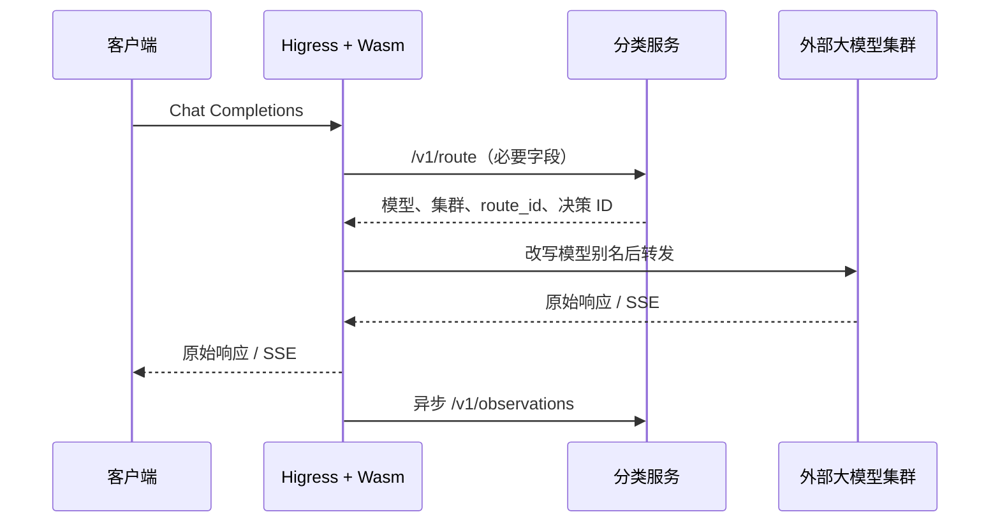

# Higress 外部分类路由插件

适配 Higress **v2.2.5**。插件暂停 Chat Completions 请求，向 Python 分类服务取得持久化决策，验证本地目标白名单后改写 `model` 和 `x-semantic-route`，恢复 Higress 转发。最终生成请求与 SSE 均不经过 Python 服务。



## 编译与实际代理测试

Go SDK 固定为 Higress 2.2.5 `model-router` 扩展所用的提交 `77e9cce339d2`，使用标准 Go WASI reactor 构建，无需 TinyGo。复现工具链为 Go 1.27.3。以下命令在仓库根目录执行，先完成项目的 `uv sync`：

```bash
uv run python scripts/adaptive/bootstrap_higress.py --destination /tmp/adaptive-tools --go --gateway
export PATH="/tmp/adaptive-tools/go/bin:$PATH"
uv run make -C plugins/higress-adaptive test build OUT=/tmp/adaptive-routing.wasm
HIGRESS_ENVOY=/tmp/adaptive-tools/envoy ADAPTIVE_WASM=/tmp/adaptive-routing.wasm \
  uv run pytest tests/integration/adaptive/test_higress_wasm.py -q
```

工具下载脚本限 Linux amd64，gateway 下载需要 `skopeo`，不依赖 Docker daemon。Go 压缩包、OCI manifest、各镜像层和 Envoy 二进制均验证 SHA256。实际代理取自官方 2.2.5 镜像，报告 Envoy `1.36.10`；未用普通 Envoy 模拟 Higress 的重路由扩展。

已执行的真实代理测试覆盖：两个上游目标切换、模型别名及其他生成参数保留、分片 SSE 字节一致、排除分类耗时的 TTFT、请求结束后的根上下文上报、分类超时/异常/非法目标/固定模型不匹配、过大与重复 JSON 键请求、上游断流。原生 SDK 测试还覆盖热更新隔离、重试/队列边界、非流式 TTFT 未知和分片 UTF-8 BOM。

## 配置与路由约束

见 [config.example.json](config.example.json)，目标映射与仓库的 `examples/adaptive/service.yaml` 一致。每个配置绑定一个可信租户，不能从客户端请求头指定租户。`route_token`、`observe_token` 是分类服务凭证；示例服务的 `GATEWAY_TOKEN` 同时拥有两种权限，因此这两个值可以相同。不要把实际凭证提交到 Git 或客户端配置。

| 字段 | 含义 |
| --- | --- |
| `classifier_cluster` | 已由 Higress 配置好的 Envoy 集群名；不是任意 URL |
| `classifier_authority` | 分类请求的 Host；TLS 由该集群的 transport socket 配置 |
| `path` | 精确匹配的请求路径，默认 `/v1/chat/completions`，忽略 query 部分 |
| `timeout_ms` | 单次分类/观测调用期限，1–30000 ms，默认 5000 |
| `max_body_bytes` | 原始生成请求上限，1024–1048576，默认 262144；同时设置 Higress 解码缓冲上限 |
| `targets` | `route_id → model_id / cluster_id / upstream_model`，每项必须与服务返回完全一致 |

Higress 路由按 `x-semantic-route` 匹配到预先配置的 Service/集群。插件首先删除客户端同名头与伪造的决策 ID，只写入校验后的值。Higress 默认在请求头修改后清除路由缓存；**不要设置 `clear_route_cache=off`**。未匹配内部目标的默认路由应拒绝请求。

此插件应覆盖该主机上的全部候选路由；它们必须共享同一套前置认证、租户绑定和授权规则。不能在部分目标路由上关闭插件或放松认证，否则路由重算可能穿过不同的授权配置。分类服务还会检查租户、固定模型、工具/模态/schema 和上下文限制。

插件拥有 `auto` 模型选择和最终别名改写。相同路径不再启用另一个 `model-router`，避免二次选择。默认直接转发 OpenAI 兼容上游；若另加 `ai-proxy` 做厂商协议转换，需在部署中单独验证其插件顺序、别名映射和流格式。当前运行证据是直接转发链路，不宣称验证了所有厂商转换插件。

分类请求仅包含 `messages`、`tools`、`tool_choice`、`response_format`、生成长度限制、`stream`、逻辑模型与身份字段。其他生成参数保留在转发请求中。JSON 重复键、过深嵌套、压缩请求、请求 trailers 和无效协议会被拒绝。分类失败返回 5xx；不绕过硬约束选择备用大模型。

## 计时与可靠性边界

`x-semantic-decision-id` 响应头可供有权限的质量评价程序关联反馈。网关只提交运行观测，不生成质量标签。`x-request-id` 是分类幂等键；Higress 通常自动提供，没有时插件生成随机 ID。同一 ID 必须代表同一逻辑请求；并发重复生成不代表新的学习样本，持久层按决策去重。需要多次独立生成时使用不同 ID。

- TTFT 从分类成功、恢复请求转发前开始，截止首个完整 SSE 事件中出现非空文本、reasoning、refusal 或工具函数名/参数。它包含此后的网关过滤、连接和排队时间，不是精确的模型服务器内部计时。
- 总延迟截止响应结束或已识别的 reset。非流式、压缩流、无有效 token、超大/损坏 SSE 首事件的 TTFT 为 `null`；不会把响应头或心跳计作 token。只接受 OpenAI Chat Completions 的 delta 结构。
- 响应体只读、不替换、不暂停；SSE 解析内存上限 64 KiB，找到首 token 后停止解析。HTTP 2xx 完整结束代表传输成功，不等于内容正确；HTTP 429/5xx 和已知上游 flags 属于运行失败。未知 reset 不伪造成功。
- 每个 Wasm 根上下文最多保存 1024 条待上报/在途观测，最多并发 16 次上报；每 100 ms 排空，最多尝试 3 次，排队期限 30 秒。重试保持同一事件 ID 和内容。
- 队列属于网关内存，进程崩溃、插件替换或持续过载可能丢失观测；不因此阻塞 SSE。分类服务已经持久化的决策与学习状态不受影响；未回收 inflight 最终按决策 TTL 过期。
- 有 `adaptive_route_errors`、`adaptive_observations_delivered`、`adaptive_observations_dropped`、`adaptive_observations_unknown_outcome` 四类低基数计数器。配置、提示词和凭证不进入插件日志。

原始请求与提取后的 envelope 大小不同，分类服务的 `max_request_bytes` 应留出序列化余量。配置服务访问凭证只用于内部分类/观测调用，不转发给模型集群；上游模型鉴权由现有 Higress 配置负责。

参考：[Higress Go 插件开发](https://higress.io/docs/latest/user/wasm-go/)、[固定版本的 model-router](https://github.com/higress-group/higress/blob/4deae1dd3b4cb2707273748985e55bef28e747d1/plugins/wasm-go/extensions/model-router/go.mod)、[SSE 解析规范](https://html.spec.whatwg.org/multipage/server-sent-events.html#parsing-an-event-stream)、[Envoy 1.36.10 response flags](https://github.com/envoyproxy/envoy/blob/v1.36.10/envoy/stream_info/stream_info.h)。
